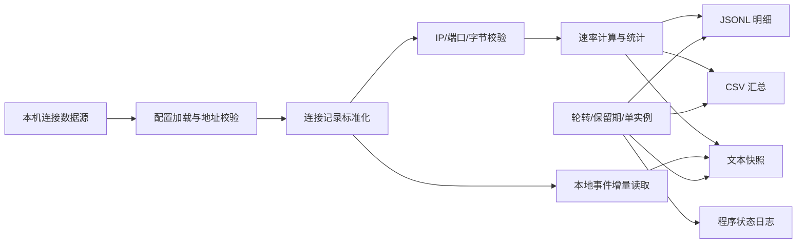

# traffic-logger 开发任务书

> 面向 Claude Code 的可执行工程规格。本文档是开发约束、数据契约和验收依据，不是泛泛的产品介绍。

| 项目 | 内容 |
|---|---|
| 项目名称 | traffic-logger |
| 项目定位 | Windows 本地连接元数据监控脚本/软件 |
| 当前版本 | v1.1.0-dev |
| 文档日期 | 2026-08-15 |
| 主要语言 | Python 3 |
| 运行环境 | Windows 10/11；Python 3.10+ |
| 依赖策略 | 生产运行只使用 Python 标准库 |
| 数据范围 | 本机已授权数据源提供的连接元数据 |
| 核心输出 | 真实目标 IP、端口、上下行字节、速率、时间 |

---

## 0. 给 Claude Code 的执行契约

请把本任务书当作本项目的实现边界和完成标准，按下面顺序执行：

1. 先读取项目根目录及父目录的 `AGENTS.md`、`README.md`、现有测试和配置；执行 `git status --short --branch`，保留已有未提交修改。
2. 先理解现有实现，再修改；不得凭文件名猜测接口或数据结构。
3. 只实现本任务书范围内的连接元数据监控，不增加通信内容采集、通信控制、远程数据传输或与核心目标无关的识别字段。
4. 数据源不可用、字段不完整或数据无法确认时，记录明确错误或统计信息，不得用域名、问号、空字符串或猜测值冒充真实 IP/端口。
5. 每个逻辑阶段完成后进行对应的最小验证；不得删除、减弱或跳过失败测试。
6. 修改前后都检查敏感数据、专属配置、运行时日志和生成文件，不能把真实密钥、令牌、个人隐私或机器专属路径写入代码、测试和文档。
7. 完成时报告：修改文件、验证命令、实际结果、未验证事项和已知风险；只有实测通过的项目才能标记为完成。

### 0.1 一句话完成定义

在获得本机合法授权并可访问本地连接数据源的前提下，程序能够稳定采样，严格输出带真实 IP 和端口的上下行流量元数据，所有数据只在本机落盘，异常可追踪，日志可按日轮转和按策略清理，测试和文档与实际行为一致。

### 0.2 任务边界关键词

本项目只处理：`时间`、`本地 IP/端口`（数据源确实提供时）、`真实目标 IP/端口`、`协议`（数据源确实提供时）、`上传字节`、`下载字节`、`连接数量`和`采集状态`。

本项目不处理：通信内容、报文载荷、账号密码、Cookie、令牌、域名解析结果、应用进程名、规则名、路径名、链路节点、通信控制、路由修改、加解密、远程扫描和数据上传。

---

## 1. 项目目标与验收口径

### 1.1 业务目标

1. 以固定采样间隔记录本机连接的上下行累计字节和速率。
2. 对每条连接保留可核验的真实目标 IP 和目标端口。
3. 通过 JSONL、CSV、文本快照和程序日志提供可回溯的本地记录。
4. 在不读取通信内容、不改变通信行为的前提下，支持流量异常定位和运行故障排查。
5. 提供清晰的安装、启动、停止、卸载和日志保留规则。

### 1.2 成功标准

- 采集接口只访问本机回环地址或经部署人明确授权的本地数据源。
- 主明细文件中的每一条记录都有格式正确的 `remote_ip` 和 `remote_port`。
- 上下行字节均为非负整数；速率计算不会产生负值或静默伪造值。
- 所有日志均落在配置的本地目录；程序不主动向外部地址发送采集结果。
- 配置错误、接口不可达、数据格式错误、写盘失败和重复启动均有可识别结果。
- 单元测试、集成测试、静态检查和人工验收均有实际执行记录。

---

## 2. 范围、非目标与合规边界

### 2.1 范围内

| 编号 | 范围 | 要求 |
|---|---|---|
| S-01 | 本地数据采集 | 从本机回环接口或本地连接事件文件读取已存在的连接元数据。 |
| S-02 | 端点识别 | 识别并校验 IPv4/IPv6 地址及 1-65535 范围内的端口。 |
| S-03 | 流量统计 | 记录连接累计上传/下载字节，并计算采样周期速率。 |
| S-04 | 本地留存 | JSONL 保存连接明细，CSV 保存周期汇总，文本保存人工可读快照。 |
| S-05 | 稳定运行 | 支持轮询、重试、跨日文件切换、保留期清理和单实例保护。 |
| S-06 | 运维交付 | 提供配置校验、启动/停止说明、安装脚本和卸载脚本。 |

### 2.2 明确不做

- 不读取、解析、保存或展示通信内容和报文载荷。
- 不收集与流量统计无关的身份信息、账号信息、应用进程信息或用户行为标签。
- 不把域名、未知文本、默认占位符或推测结果写入 `remote_ip`。
- 不修改系统网络配置，不控制连接，不转发连接，不注入报文。
- 不主动访问远程服务，不提供远程控制接口，不上传日志。
- 不实现内容审查、内容分类、账号画像、应用识别或可视化平台。
- 不在示例、测试、日志和文档中保留任何特定第三方网络通信工具的名称、专属目录、专属端口、专用配置或使用教程。

### 2.3 合规工程边界

本项目提供的是技术工具，不自行构成合规认证，也不替代部署单位的法律、隐私和网络安全评估。部署人应根据主体身份、使用场景、数据类型、内部制度和适用的最新法律法规确定最终策略。

工程实现至少遵守以下原则：

1. **合法授权**：只监控部署人拥有管理权或已取得明确授权的设备和数据源。
2. **目的限定**：仅为网络运行状态、流量统计、故障排查和安全审计留存必要元数据。
3. **最小必要**：默认不采集内容、身份、进程、规则、路径等非必要字段。
4. **本地处理**：数据默认只写本地文件，不配置远程日志地址，不在错误信息中输出密钥。
5. **访问控制**：日志目录应使用操作系统权限限制访问；生产部署应按单位制度配置备份、审计和删除权限。
6. **期限管理**：留存期限以适用法律法规、行业要求和内部制度为准；若部署场景适用网络日志至少留存六个月的要求，应将 `log_retention_days` 配置为不低于 180，并进行容量评估。
7. **个人信息保护**：IP 地址在具体场景下可能与可识别个人关联，应执行告知、授权、访问控制、最小化、到期删除和审计等要求。
8. **数据安全**：涉及重要数据、敏感数据或集中部署时，应在上线前完成分类分级、加密、备份、权限和风险评估。

### 2.4 参考依据

开发和上线前应以官方发布的最新有效文本为准，至少核对：

- 《中华人民共和国网络安全法》；
- 《中华人民共和国数据安全法》；
- 《中华人民共和国个人信息保护法》；
- 适用的行业主管部门规定、网络安全等级保护要求和单位内部制度。

任务书中的“六个月”“最小必要”和“本地留存”等内容是工程控制要求，不代表对具体主体是否承担某项法定义务作出判断。

---

## 3. 现有实现基线与本次开发目标

### 3.1 当前目录

```text
traffic_logger/
├── traffic_logger.py       # 当前主程序
├── config.json             # 当前配置
├── install.bat             # 当前安装脚本
├── uninstall.bat           # 当前卸载脚本
├── TASK_BOOK.md            # 本任务书
├── logs/                   # 运行时输出，不应作为源码提交
└── __pycache__/            # Python 运行时缓存，不应作为源码提交
```

当前目录如缺少 `README.md` 或 `tests/`，应在开发中补齐，不得在任务书中假设它们已经存在。

### 3.2 当前代码需要核对的行为

当前主程序已经具备以下基础能力，但需要按本任务书收敛字段和边界：

- 读取配置中的本地 HTTP 数据接口并调用连接列表接口。
- 读取连接累计上传/下载计数。
- 写入周期汇总、连接明细、连接快照和程序状态日志。
- 按日期切换文件、清理旧文件，并使用本地端口实现单实例保护。
- 可从本地事件文件增量读取连接建立信息。

以下差距必须在实现阶段处理：

1. 明细记录统一使用 `remote_ip` 和 `remote_port`，不再以 `host` 或文本占位符承担 IP 字段。
2. 对 IP 地址和端口进行显式校验；无效记录不得进入主明细文件，并要有可统计的丢弃原因。
3. 删除与本项目目标无关的规则、路径、节点、进程等输出字段。
4. 连接事件只保留时间、协议、真实 IP 和端口；解析失败不得循环刷屏。
5. 配置路径、示例、注释和日志内容必须使用通用项目命名，不保留特定软件专属信息。
6. 安装脚本不得依赖开发机的绝对路径；应优先使用 `%~dp0`、可配置的 Python 路径或清晰的前置检查。
7. 增加自动化测试，不能只通过人工运行判断完成。

---

## 4. 功能需求

### 4.1 数据采集与校验

| 编号 | 功能 | 可验证要求 |
|---|---|---|
| FR-01 | 本地数据源 | 仅允许本机回环地址或明确配置的本地文件；启动时校验地址、协议和必要配置。 |
| FR-02 | 连接读取 | 周期读取当前连接列表和总上传/下载计数；接口失败时重试并写入错误状态。 |
| FR-03 | 目标 IP | 接受格式正确的 IPv4/IPv6 字面量；禁止把域名或任意文本当作 IP。 |
| FR-04 | 目标端口 | 接受整数 1-65535；字符串数字须先安全转换，其他值判为无效。 |
| FR-05 | 本地端点 | 数据源提供且通过校验时记录 `local_ip`、`local_port`；未提供时使用 `null`，不得猜测。 |
| FR-06 | 计数器 | 上传/下载累计值必须为非负整数；计数器回退时重新建立基线，不输出负速率。 |
| FR-07 | 时间 | 使用带时区的 ISO 8601 时间；同一采样周期的记录使用一致的采样时间。 |
| FR-08 | 协议 | 只有数据源明确提供时记录协议；未知协议使用 `null`，不得从端口推断。 |
| FR-09 | 无效数据 | 无效连接只计入无效计数和程序日志，不进入有效明细和 TOP 统计。 |

### 4.2 日志输出

| 编号 | 功能 | 可验证要求 |
|---|---|---|
| FR-10 | 连接明细 | 每个有效连接每次采样写一行 JSONL，字段符合第 5 节契约。 |
| FR-11 | 周期汇总 | 每个采样周期写一行 CSV，包含上下行速率、连接数和有效/无效计数。 |
| FR-12 | 连接快照 | 按 `conn_snapshot_every` 写入可读快照，只显示 IP、端口、字节、时间和协议。 |
| FR-13 | 事件记录 | 本地事件文件采用偏移游标增量读取；事件记录只包含规定的端点元数据。 |
| FR-14 | 程序日志 | 记录启动、停止、重试、校验失败、写盘失败、清理和异常堆栈摘要；不得记录密钥。 |
| FR-15 | 轮转 | 文件名含本地日期，跨日自动切换，已有文件追加时不重复写表头。 |
| FR-16 | 清理 | 仅删除日志目录内超过保留期的日志文件；不删除源码、配置、测试和用户指定目录。 |
| FR-17 | 单实例 | 重复启动时给出清晰提示并正常退出，不破坏已有实例和日志。 |

### 4.3 运维功能

| 编号 | 功能 | 可验证要求 |
|---|---|---|
| OPS-01 | 配置校验 | 启动前校验配置类型、范围、路径和本地地址；错误信息包含字段名和修复建议。 |
| OPS-02 | 启动方式 | 支持前台启动和计划任务启动；两者使用同一配置和同一日志目录。 |
| OPS-03 | 停止方式 | 支持 Ctrl+C 或卸载脚本停止；停止后文件句柄和单实例锁正常释放。 |
| OPS-04 | 安装脚本 | 使用相对项目路径，检查 Python、脚本和权限；失败时返回非零退出码。 |
| OPS-05 | 卸载脚本 | 只停止本项目实例、删除本项目计划任务，默认保留日志并明确提示。 |
| OPS-06 | 运行状态 | 接口不可用时持续重试但不过度刷屏；恢复后自动继续采集并记录恢复事件。 |

---

## 5. 数据契约

### 5.1 JSONL 连接明细

文件名：`connections_detail_YYYYMMDD.jsonl`

每行一个 JSON 对象。有效记录字段如下：

| 字段 | 类型 | 必填 | 约束 |
|---|---|---:|---|
| `ts` | string | 是 | 带时区的 ISO 8601 时间。 |
| `local_ip` | string/null | 否 | 数据源明确提供且通过 IP 校验时填写。 |
| `local_port` | integer/null | 否 | 1-65535；无法确认时为 `null`。 |
| `remote_ip` | string | 是 | 通过标准库 IP 校验的 IPv4/IPv6 字面量。 |
| `remote_port` | integer | 是 | 1-65535 的整数。 |
| `protocol` | string/null | 否 | 数据源明确提供的协议值；不做端口推断。 |
| `up_bytes` | integer | 是 | 当前连接累计上传字节，非负整数。 |
| `down_bytes` | integer | 是 | 当前连接累计下载字节，非负整数。 |
| `source` | string | 是 | 固定为本地数据源类别，不写入地址、令牌或机器隐私。 |

示例仅用于说明结构，使用文档保留地址，不代表实际采集对象：

```json
{"ts":"2026-08-15T10:20:30+08:00","local_ip":null,"local_port":null,"remote_ip":"203.0.113.10","remote_port":443,"protocol":"TCP","up_bytes":1024,"down_bytes":2048,"source":"local_api"}
```

禁止字段：`host`、域名、规则、路径、节点、进程、账号、令牌、通信内容以及任何未在本契约中定义的敏感字段。

### 5.2 CSV 周期汇总

文件名：`traffic_YYYYMMDD.csv`

固定表头：

```text
timestamp,upload_kbs,download_kbs,active_connections,valid_connections,invalid_connections,total_upload_bytes,total_download_bytes
```

要求：

- `upload_kbs`、`download_kbs` 为当前采样周期速率，单位 KB/s，保留一位小数。
- `active_connections` 为数据源当前返回的连接总数。
- `valid_connections` 与有效明细条数一致。
- `invalid_connections` 记录被校验拒绝的连接数量。
- `total_upload_bytes`、`total_download_bytes` 为数据源的累计总量；读取失败不得静默写零。
- CSV 字段中不得嵌入换行、密钥或未经校验的原始文本。

### 5.3 文本快照

文件名：`connections_YYYYMMDD.log`

每次快照包含：采样时间、当前连接数、上下行速率，以及最多 40 条按总字节数排序的有效连接。每行至少包括：

```text
timestamp=2026-08-15T10:20:30+08:00 active=1 up_kbs=1.0 down_kbs=2.0
remote=203.0.113.10:443 up_bytes=1024 down_bytes=2048 protocol=TCP
```

### 5.4 事件文件

文件名：`events_YYYYMMDD.log`

只记录已经从本地事件数据中校验成功的：`ts`、`protocol`、`remote_ip`、`remote_port`。文件轮转或截断时重置偏移游标；解析失败只增加计数并限频写入程序日志。

### 5.5 程序日志

文件名：`app.log`

至少覆盖以下事件：

- `STARTED`、`STOPPED`、`INSTANCE_EXISTS`
- `SOURCE_UNAVAILABLE`、`SOURCE_RECOVERED`
- `INVALID_RECORD`、`COUNTER_RESET`
- `WRITE_ERROR`、`ROTATED`、`CLEANUP`
- `UNEXPECTED_ERROR`

程序日志不得写入认证密钥、完整配置、通信内容和未经必要性评估的原始数据。

---

## 6. 配置契约

### 6.1 配置示例

```json
{
  "api": {
    "url": "http://127.0.0.1:9097",
    "secret": "set-your-secret"
  },
  "monitor": {
    "interval_seconds": 2,
    "conn_snapshot_every": 30,
    "log_retention_days": 180,
    "gateway_log_path": "%LOCALAPPDATA%\\traffic_logger\\connection_events.log",
    "log_dir": "logs"
  }
}
```

### 6.2 配置规则

| 配置项 | 默认值 | 校验 |
|---|---:|---|
| `api.url` | `http://127.0.0.1:9097` | 只允许本机回环地址；禁止空值、远程地址和不明协议。 |
| `api.secret` | 占位符 | 不得提交真实密钥；错误日志只显示配置项名称。 |
| `monitor.interval_seconds` | `2` | 浮点数，建议 2-60；不得小于 1。 |
| `monitor.conn_snapshot_every` | `30` | 正整数，且不小于采样间隔。 |
| `monitor.log_retention_days` | `180` | 正整数；按适用制度配置，需评估磁盘容量。 |
| `monitor.gateway_log_path` | 项目本地事件文件 | 只允许本地路径；不得指向不明软件专属目录。 |
| `monitor.log_dir` | `logs` | 默认相对项目目录；清理操作仅限该目录。 |

实现要求：

1. 配置加载失败时立即退出并给出可读错误，不进入半初始化状态。
2. 对路径进行环境变量展开和绝对路径解析，但不得把解析后的机器专属路径写入业务日志。
3. `secret` 只能用于本地接口认证；不进入异常、命令行回显、CSV、JSONL、快照或事件日志。
4. 如果未来改名为更准确的配置键，须提供一次性迁移提示和测试，不得静默丢失旧配置。

---

## 7. 技术设计



### 7.1 模块边界

| 模块 | 职责 | 禁止承担的职责 |
|---|---|---|
| 配置模块 | 加载、展开、校验配置 | 发送采集结果、输出密钥 |
| 数据源客户端 | 调用本地接口、解析响应 | 自动发现远程地址、修改系统设置 |
| 标准化模块 | 提取 IP、端口、协议和字节 | 把域名或文本猜成 IP |
| 统计模块 | 计算差值、速率、有效/无效数量 | 生成缺失数据、掩盖计数器回退 |
| 日志模块 | 写 JSONL/CSV/文本、轮转和清理 | 删除源码或任意用户文件 |
| 事件读取模块 | 本地文件偏移读取和限频报错 | 保存无关原始行 |
| 运维模块 | 单实例、启动停止、计划任务 | 控制通信或更改网络行为 |

### 7.2 速率计算

```text
delta = current_total - previous_total
如果 previous_total 为空：本周期速率为 0，并建立基线
如果 delta < 0：记录 COUNTER_RESET，本周期速率为 0，并重新建立基线
否则：rate_kbs = delta / elapsed_seconds / 1024
```

实现必须使用实际经过的时间或明确的采样间隔，不得因接口延迟、睡眠漂移或异常重试而产生明显错误速率。接口失败期间不能用旧值冒充新值。

### 7.3 错误处理

- 可恢复的接口失败：按退避或固定间隔重试，程序日志限频。
- 单条记录无效：跳过该条，累计原因和数量，继续处理其他有效记录。
- 日志写入失败：写入错误后停止继续伪造数据，并以非零状态暴露故障。
- 配置错误：启动前失败，返回非零状态，不创建不完整的业务日志。
- 未捕获异常：记录类型和摘要，释放句柄和锁，再退出。

---

## 8. 分阶段实施计划

每个阶段都要先修改、再验证、再进入下一阶段；完成报告应给出实际命令和结果。

### 阶段 A：基线与安全边界

- [ ] 读取项目规范和当前代码，确认工作区状态。
- [ ] 为运行时日志、CSV、JSONL、缓存和本地临时文件补充 `.gitignore`。
- [ ] 清理配置、注释、示例和默认路径中的专属信息。
- [ ] 将固定机器路径改为项目相对路径、环境变量或启动参数。
- [ ] 验证：全项目文本检索、`git diff --check`、配置 JSON 解析。

### 阶段 B：输入标准化

- [ ] 增加 IPv4/IPv6 校验函数。
- [ ] 增加端口范围校验函数。
- [ ] 统一字段为 `remote_ip`、`remote_port`、`local_ip`、`local_port`、`protocol`、`up_bytes`、`down_bytes`。
- [ ] 删除非核心字段和域名兜底逻辑。
- [ ] 为缺失、错误类型、越界、域名输入和计数器回退增加测试。
- [ ] 验证：单元测试全部通过，且无无效 IP/端口进入有效 JSONL。

### 阶段 C：日志契约与轮转

- [ ] 按第 5 节固定 JSONL/CSV/文本字段和表头。
- [ ] 确保跨日写入、追加表头、文件句柄关闭和保留期清理行为稳定。
- [ ] 清理逻辑限定在配置日志目录，并覆盖不存在目录、只读文件和异常文件名场景。
- [ ] 验证：临时目录测试跨日文件、过期文件、表头唯一性和权限失败。

### 阶段 D：运行可靠性

- [ ] 统一配置校验、错误码、重试和恢复事件。
- [ ] 校验本地地址，防止配置把采集目标指向未授权地址。
- [ ] 确保认证信息不会出现在任何日志和命令行输出中。
- [ ] 保证单实例锁在正常停止和异常退出后可恢复。
- [ ] 验证：接口不可达、接口恢复、重复启动、Ctrl+C、异常响应和写盘失败。

### 阶段 E：安装与交付

- [ ] 安装脚本使用项目相对路径并检查前置条件。
- [ ] 卸载脚本只处理本项目计划任务和进程，默认保留日志。
- [ ] 补充 `README.md`：安装、配置、启动、停止、日志字段、留存、排障和权限说明。
- [ ] 补充 `tests/` 及一条可重复执行的集成测试命令。
- [ ] 验证：在干净临时目录完成安装检查、启动检查、停止检查和日志检查。

---

## 9. 测试计划

### 9.1 单元测试

建议文件：`tests/test_traffic_logger.py`

| 测试组 | 必测场景 | 预期 |
|---|---|---|
| 配置 | 合法配置、缺字段、错误类型、远程地址、非法间隔 | 合法配置通过；错误配置明确失败。 |
| IP | IPv4、IPv6、域名、空值、非法字符 | 只有字面量 IP 通过。 |
| 端口 | 1、443、65535、0、65536、文本、空值 | 只有 1-65535 整数通过。 |
| 字节 | 0、正数、负数、浮点、缺失、计数器回退 | 非法值拒绝；回退重新建立基线。 |
| 时间 | 时区、跨日、文件名日期 | 时间格式稳定，文件按日期切换。 |
| 日志 | 首行表头、追加、轮转、清理、写入异常 | 无重复表头，不越权删除。 |
| 事件 | 增量读取、截断、轮转、坏行、重复读取 | 不重复、不刷屏、坏行不污染有效日志。 |
| 单实例 | 第一实例、第二实例、释放后重启 | 第二实例安全退出，释放后可再次启动。 |
| 安全 | 密钥、配置、错误、异常输出 | 任何输出都不包含密钥。 |

### 9.2 集成测试

使用仅监听本机回环地址的测试数据源，不访问远程服务：

1. 返回一条有效 IPv4 连接、一条有效 IPv6 连接、一条域名记录和一条非法端口记录。
2. 运行至少三个采样周期。
3. 检查有效明细只含两条合格记录，域名和非法端口只进入无效计数。
4. 检查 CSV 速率、连接数、有效数、无效数和累计量一致。
5. 让总计数器回退一次，确认没有负速率。
6. 模拟接口断开后恢复，确认程序日志出现失败和恢复状态。
7. 检查所有输出文件不含认证密钥和未定义字段。

### 9.3 人工验收

- [ ] 使用经授权的本地数据源运行不少于 60 秒。
- [ ] 实际看到 `traffic_YYYYMMDD.csv` 持续追加。
- [ ] 实际看到 JSONL 记录中的 `remote_ip` 可被标准库校验，`remote_port` 在合法范围。
- [ ] 实际看到快照文件按配置周期追加。
- [ ] 实际看到程序停止后句柄关闭，能够再次启动。
- [ ] 实际启动第二个实例，确认不覆盖第一个实例的日志。
- [ ] 对配置日志目录执行到期清理演练，确认只删除目标日志。
- [ ] 检查安装和卸载脚本的返回码、提示和日志保留行为。

### 9.4 必执行命令

在项目根目录执行并保存结果：

```powershell
python -m py_compile traffic_logger.py
python -m unittest discover -s tests -v
python -m json.tool config.json
git diff --check
```

如果测试目录尚未创建，必须先补测试或明确记录未执行原因，不得把“没有测试”当作通过。

---

## 10. 交付物清单

### 10.1 必交付

1. `traffic_logger.py`：主程序及输入校验、统计、写盘、轮转、错误处理。
2. `config.json`：不含真实密钥和机器专属路径的默认配置。
3. `install.bat`：可检查前置条件并使用项目相对路径的安装脚本。
4. `uninstall.bat`：只处理本项目实例和任务、默认保留日志的卸载脚本。
5. `TASK_BOOK.md`：本开发任务书。
6. `README.md`：面向使用者的安装和运行说明。
7. `tests/`：覆盖核心数据契约和失败路径的自动化测试。
8. `.gitignore`：排除日志、缓存、临时输出、密钥和本机配置。

### 10.2 不得交付

- 真实认证信息、真实用户通信内容、未脱敏的测试抓包或个人数据。
- 与本项目无关的网络工具安装包、配置备份、专属日志样本或使用说明。
- 不能复现的“已验证”结论、空测试报告或只描述未执行步骤的验收记录。

---

## 11. 版本与变更管理

### v1.1.0-dev：本任务书范围

- 明确项目仅处理本地连接元数据。
- 统一真实 IP、端口、上下行字节和时间字段。
- 增加输入校验、错误处理、日志契约和测试要求。
- 规范安装脚本、配置、保留期和隐私边界。

### 后续版本候选

只有在不扩大数据范围、不改变本地处理边界并完成隐私评估后，才可讨论：

- 日/小时聚合报表；
- 本地静态查询命令；
- 采集健康度检查；
- 本地只读可视化。

任何新增字段必须先说明必要性、来源、保存期限、访问权限和测试方式；默认不接受进程、账号、通信内容或远程上传相关需求。

---

## 12. Claude Code 最终回报模板

完成后按以下格式回报，不要只说“已完成”：

```text
实现结果：<一句话说明可观察行为>

修改文件：
- <文件>：<修改目的>

验证命令与结果：
- <命令>：PASS/FAIL，<关键输出>

人工验收：
- <已实际观察到的结果>

未验证事项与风险：
- <没有执行的项目及原因；没有则写“无”>

Git：
- <分支、提交哈希、工作区状态>
```

只有满足实现、测试、人工验收、差异复核和 Git 状态检查后，才能将任务标记为完成。
